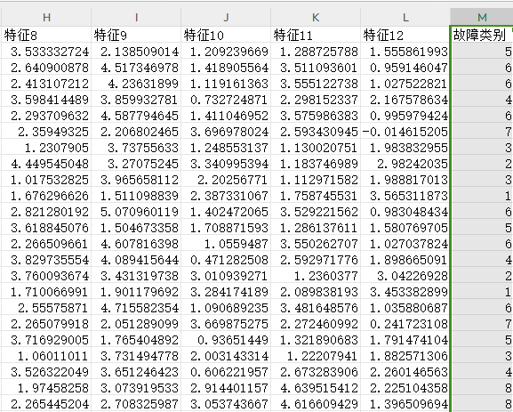
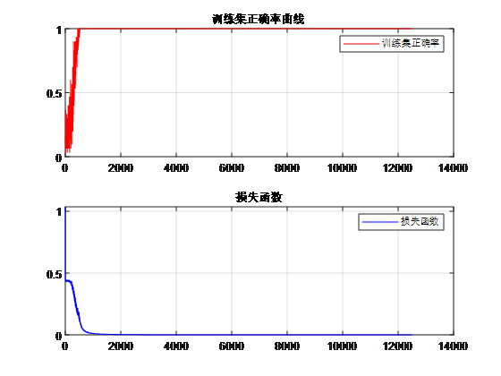
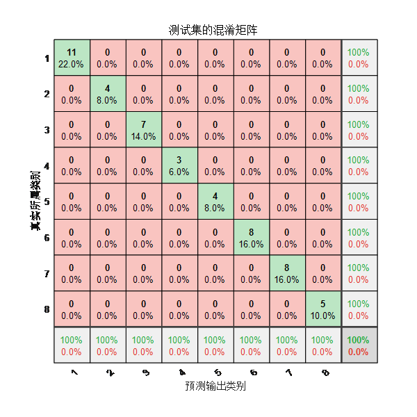
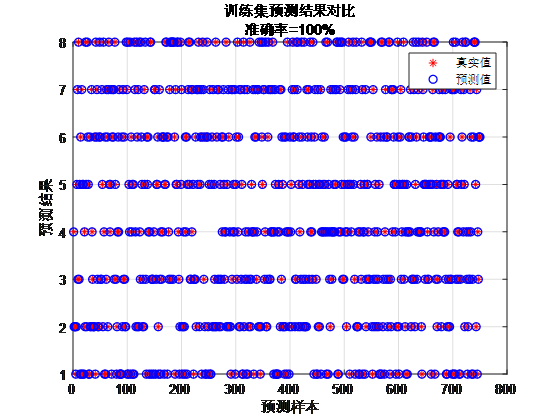
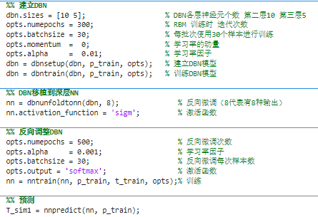

# Fault Identification: Deep Belief Network (DBN) for data classification prediction/fault identification algorithm, MATLAB program, version 2021b and above.

The program platform requirements: Requirements for version 2021b and above.
Applicable to bearing fault identification/diagnosis/classification, transformer oil gas fault identification/diagnosis/classification, power system transmission line fault area identification/diagnosis/classification, insulator and distribution network fault identification/diagnosis/classification, etc.
Direct import using an Excel table without needing significant modifications to the program. The program contains detailed comments for easy understanding of the program's operation.
Data format:
Each row represents a fault waveform sample, with the last column indicating the fault category of that sample.
Training curve:
Confusion matrix for the test set: (bottom-right corner is the final accuracy, precision is the bottom row of the confusion matrix, recall is the rightmost column of the confusion matrix)
Precision: Refers to how many of the samples predicted as positive by the model are actually true positives.
Recall: Refers to how many actual positive samples are correctly predicted by the model.
Training set scatter plot:
Partial program screenshot:

## Images

<!-- PAYMENT_BLOCK -->

## Get this dataset

- Payment link (Stripe): [Buy now](https://buy.stripe.com/3cs8yP7sY87d0vu9AB)
- Payment QR code: 

<!-- /PAYMENT_BLOCK -->
